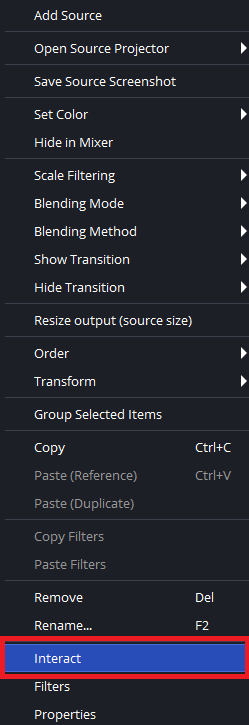
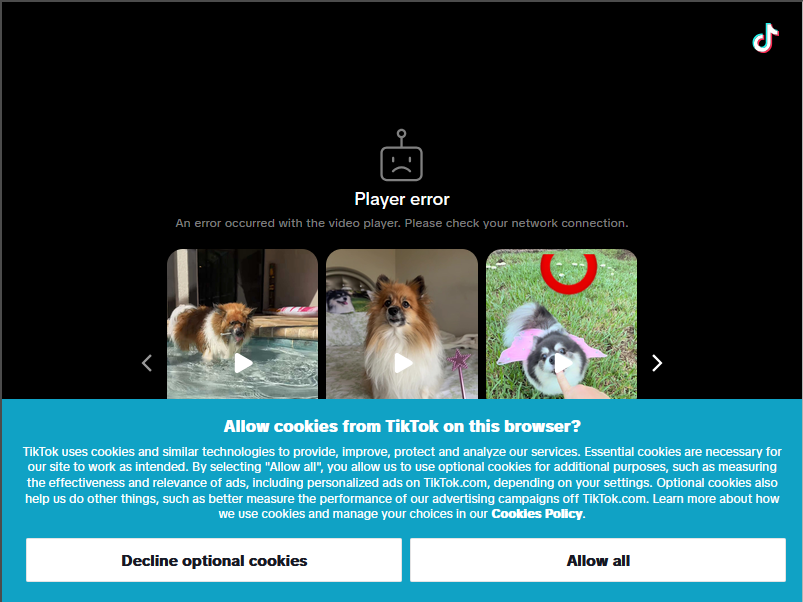

# OBS TikTok cookies

If the TikTok browser source shows a cookie prompt, accept it from OBS:

1. In OBS, right-click the TikTok browser source and select **Interact**.

   

2. In the interaction window, click **Allow all** on the TikTok cookie prompt.

   
