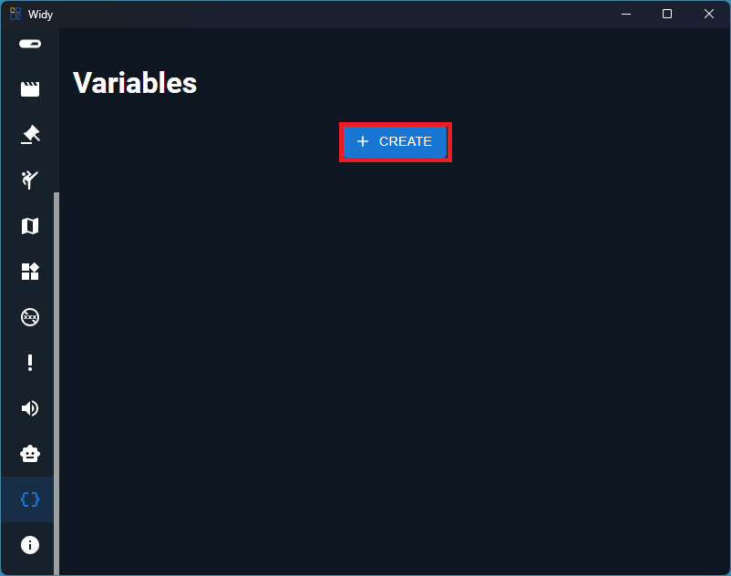
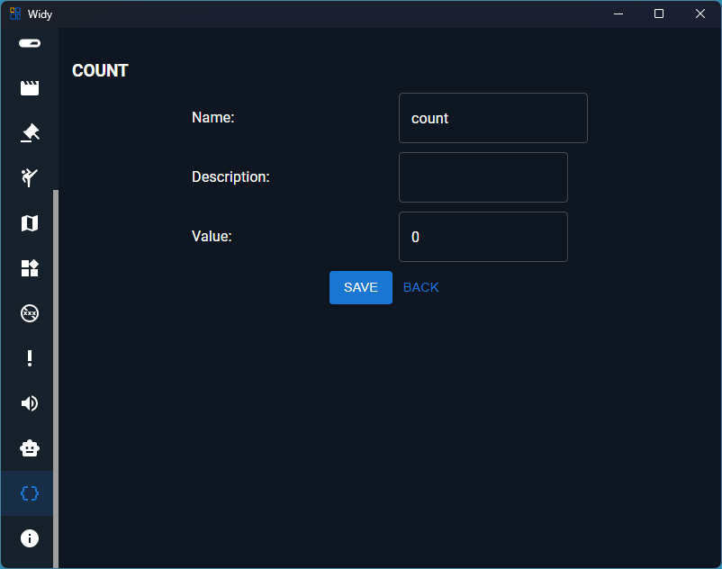
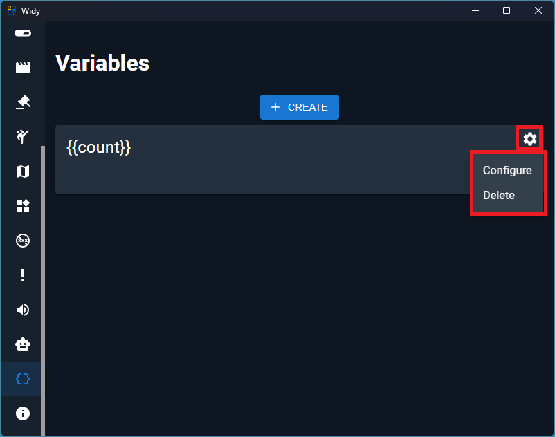

# Variables

Variables store values that you can reuse in alerts or commands. Refer to a variable by its name inside double curly braces, for example `{{count}}`.

## Create a Variable

On the Variables page, click **Create** to add a variable.

Enter a **Name**, **Description**, and **Value**, then click **Save**.

The variable name is used when referencing it in an alert or command. For example, a variable named `count` is referenced as `{{count}}`.

## Configure or Delete a Variable

Click the gear icon on a variable to open its management menu.

- **Configure** - edit the variable's name, description, or value.
- **Delete** - remove the variable.
